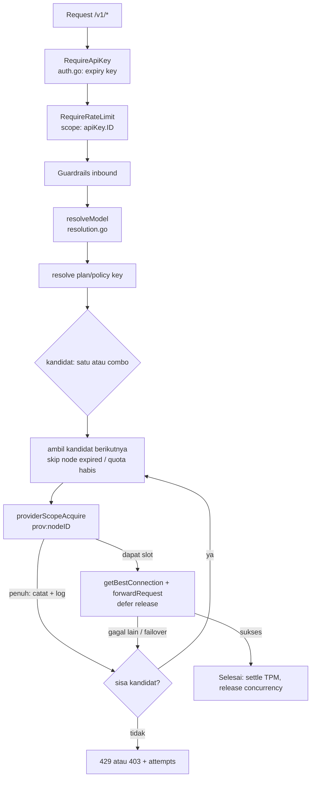

# Per-Custom-Provider Limits + Bulk Add Models — Rencana Implementasi

Status: draft rencana, belum ada kode. Ditulis 2026-10-18.
Ruang lingkup: `providerNodes` (custom provider: `openai-compatible-*` / `anthropic-compatible-*` / `custom-embedding-*`)
dan halaman model-nya di dashboard.

Dokumen ini **bukan** port KeiRouter dan **tidak** menyentuh `docs/keirouter-port-plan.md` (F-1…F-15).
Fitur di sini adalah ekstensi Go-only murni: upstream `decolua/9router` tidak punya limitasi per-node,
jadi tidak ada tabrakan paritas — cukup ikut aturan `goOnlyColumns` (schema additive).

---

## 1. Tujuan

Per **custom provider** (satu baris `providerNodes`), operator bisa menetapkan dan gateway menegakkan:

| # | Limit | Satuan | Arti |
|:--|:--|:--|:--|
| L1 | RPM (Requests Per Minute) | req/menit | laju permintaan yang endpoint ini toleransi |
| L2 | TPM (Tokens Per Minute) | token/menit | laju token masuk (prompt) yang endpoint ini toleransi |
| L3 | Concurrency | permintaan paralel | jumlah permintaan serentak ke endpoint ini |
| L4 | Lifetime quota token | token total | plafon token kumulatif (prompt+completion) sebelum node dinyatakan habis |
| L5 | Queue timeout | ms | berapa lama permintaan boleh menunggu di antrean FIFO untuk L1/L3 |
| L6 | Contract expiry | tanggal (RFC3339 UTC) | masa berlaku kontrak/langganan node; lewat tanggal = node tidak layak dipakai |

Plus: **bulk add models** di halaman custom provider — tempel banyak ID sekaligus, dipisah spasi / koma / newline
(pola yang sama dengan bulk add API key di `AddConnectionModal.svelte`).

Non-tujuan (jangan dikerjakan di rencana ini): limit per-connection, multi-tenant per-tenant budget,
Prometheus metric baru, rate limit per API key (sudah ada, F-1), plan tier (sudah ada, F-3).

---

## 2. Fakta terverifikasi (basis rencana)

**Limit per key sudah ada dan bisa ditiru 1:1.**
- `internal/middleware/ratelimit.go:23` `RateLimiter` — sliding window RPM, token bucket TPM, counter concurrency, `waitQueue` FIFO, `windowTimers`.
- `internal/middleware/ratelimit.go:83` `NewRateLimiter(window)`; `:673` `TokenUsageReader{GetApiKeyTokenUsage(rawKey)}`; `:788` `quotaCheck`.
- `internal/middleware/ratelimit.go:691` `RequireRateLimit(rl, defaults, usage)` — dipasang di `internal/handlers/router.go:541`, setelah `middleware.RequireApiKey` (`:540`), kunci = `apiKey.ID`.
- Kolom `apiKeys` (Go-only): `internal/db/schema.go:284-291` → `rateLimitRPM`, `rateLimitTPM`, `rateLimitConcurrency`, `tokenQuota`, `queueTimeoutMs`; `:306` `quotaResetId`; `:297` `expiresAt` (F-14).
- Lifetime quota diukur dari ledger, bukan counter: `internal/db/quota_reset.go:43` `ResetApiKeyQuota` (transaksi: watermark `MAX(id)` usageHistory + `UPDATE apiKeys SET quotaResetId`), `:136` `GetApiKeyTokenUsageByID`, `:182` `tokenUsageSince` (`WHERE id > ?`), `internal/db/dashboard.go:342` `GetApiKeyTokenUsage`.
- Carryover baris ledger yang sudah di-prune: tabel `usageLedgerCarryover` (`internal/db/schema.go:430`), diisi `internal/db/usage_retention_ledger.go:527`, dibaca `internal/db/quota_reset.go:194`.
- Expiry key ditegakkan di `internal/middleware/auth.go:64` (parse RFC3339 → tolak).
- Editor policy di UI: `web/src/components/keys/ApiKeyPolicyModal.svelte`; API `internal/handlers/dashboard/apikeys_policy.go` dengan semantik `mergeLimit` (definisi `:204`, dipanggil `:85-105`) — `nil` = biarkan, `0` = kosongkan.

**Custom provider = baris `providerNodes`.**
- Data blob: `internal/db/providernodes.go` `ProviderNodeData{Prefix, APIType, BaseURL}` (hanya tiga field itu).
- Repo: `GetProviderNodeByID`, `GetProviderNodeByPrefix`, `GetProviderNodePrefixMap`, `GetProviderNodes`.
- API dashboard: `internal/handlers/dashboard/routes.go:67-71` → `GET/POST /api/provider-nodes`, `PUT/DELETE /api/provider-nodes/{id}`, `POST /api/provider-nodes/validate`.
- Handler: `provider_nodes.go:101` create, `:192` update (**`name` dan `prefix` wajib di setiap PUT**), `:344` delete.
- Satu node bisa punya banyak connection; connection menunjuk node lewat `provider = node.id`.
- Identitas provider yang tercatat di ledger = **node.id** (`internal/handlers/chat/resolution.go:146,252,282` → `ModelInfo{Provider: node.ID}`), ditulis ke `usageHistory.provider` di `internal/handlers/chat/usage.go:280`. Jadi agregasi per node langsung `WHERE provider = <nodeID>`.
- Agregat per provider sudah ada: `internal/db/usage.go:167` `UsageGroupRow`, `GetUsageGroupByProviderSince`.

**Titik dispatch (tempat enforcement harus dipasang).**
- Seleksi connection: `internal/handlers/chat/connections.go:167-272` (`getBestConnectionWithContext`), error yang sudah ada di `:255` `no active connections for provider: %s` dan `:272` `no connection for provider %s has model %s enabled`.
- Forward ke upstream: `internal/handlers/chat/forward.go:27` `forwardRequest` (menaungi penulisan body termasuk streaming).
- Combo: `internal/handlers/chat/combo.go` — kandidat provider bisa berubah per attempt.
- Cooldown/kelayakan yang sudah ada: `filterConnectionsForModel`, `codexAccountServesModel`, `pinnedConnectionIneligible`, `ConnectionCooldownUntil` (`rateLimitedUntil`, `oauthLockedUntil`).

**Model custom = kv scope `customModels`** (bukan kolom di providerNodes).
- Simpan: `internal/handlers/dashboard/models.go:40` `HandleSaveCustomModel`; kunci `"<providerAlias>|<id>|<type>"` (`:63`).
- UI: `web/src/components/connections/AddCustomModelModal.svelte` — satu ID, plus capabilities (vision/reasoning) + token limits, `stripAlias()` membuang prefiks alias.
- Preseden bulk: `web/src/lib/bulk-add.ts` `planBulkAdd(lines, existingNames)` (pisah `|`, gap-fill nama anti-tabrakan) dipakai `AddConnectionModal.svelte` (mode single/bulk + `bulkResult {success, failed}`).
- Klien: `web/src/api/client.ts:1132-1174` (provider node), `:1318-1344` (`getCustomModels`, `saveCustomModel`, `deleteCustomModel`).

---

## 3. Keputusan desain

**D1 — Storage: kolom Go-only di `providerNodes`, bukan di dalam `data` JSON.**
Alasan: blob `data` adalah bentuk yang ditulis ulang oleh create/update node dan dicerminkan ke `providerSpecificData` tiap connection (`provider_nodes.go:192` komentar handler); menaruh limit di sana berarti ikut tersalin/tertimpa dan tak bisa dibaca murah saat dispatch. Kolom nyata bisa di-`SELECT` sekali per request dan di-index.
Ditolak: JSON di `data` (rapuh, tak ter-index), tabel baru `providerLimits` (join tambahan untuk data yang 1:1 dengan node).

**D2 — 0 = kosong/unlimited, "" = tanpa expiry.** Sama persis dengan konvensi `apiKeys` (`rateLimitRPM=0` berarti tak dibatasi). Tidak ada sentinel negatif.

**D3 — Dua sumbu limit yang berbeda, jangan dicampur.**
- Limit **key** (F-1/F-3) = "berapa banyak pemanggil ini boleh menghabiskan" → hak pemanggil.
- Limit **provider** (dokumen ini) = "berapa banyak endpoint ini sanggup menerima" → kapasitas upstream.
Urutan: key dulu (middleware, sudah ada), provider kedua (di handler setelah resolusi). Konsekuensi yang disengaja: pemanggil yang sudah melewati limitnya sendiri ditolak **tanpa** menyentuh kuota provider — kegagalan pemanggil tidak boleh menghabiskan anggaran node.

**D4 — Pakai ulang `RateLimiter` dengan kunci ber-namespace, bukan limiter kedua.**
Map internal limiter berkunci `string`; pakai `"prov:"+nodeID` untuk scope provider. Tidak ada kode window/queue/bucket kedua, tidak ada drift semantik antara dua scope.
Perubahan yang dibutuhkan kecil: ekspor jalur "scope key" (`Acquire`/`checkTPMOnly`/`RefundTPM` sudah menerima `key string`) + loader limit + titik pemasangan baru.

**D5 — Enforcement provider TIDAK bisa jadi chi middleware.**
Provider yang terpakai baru diketahui setelah resolusi model (alias, prefiks node, ekspansi combo — `resolution.go:146-288`, `combo.go`). Middleware berjalan sebelum body/resolusi. Jadi titik pasangnya di dalam handler chat, membungkus satu attempt dispatch, dengan `defer` release agar slot concurrency hidup selama body di-stream (`forward.go:27`).

**D6 — Jebakan failover: slot harus dilepas per attempt.**
Dalam combo/fallback, satu request bisa mencoba beberapa provider. Slot concurrency provider harus dilepas saat attempt itu berakhir (sukses, gagal, atau failover), bukan sekali di akhir request. Kalau tidak: kebocoran slot permanen dan node terkunci oleh dirinya sendiri. Wajib ada test khusus untuk ini.

**D7 — Perilaku saat limit provider terlampaui: failover dulu, 429 sebagai jalan terakhir.**
Keputusan ini dipilih Cak Helmi (2026-10-18), menggantikan usulan awal "antre lalu 429".
- **L1/L3 (RPM, concurrency)** → **antre** di FIFO yang sama sampai `queueTimeoutMs`; lewat itu node dianggap penuh **untuk attempt ini saja**.
- Node penuh **tidak langsung mengakhiri request**: attempt itu dicatat gagal-beralasan-limit, lalu loop dispatch/combo lanjut ke kandidat berikutnya (connection lain di provider sama, atau provider lain di combo yang sama). Hanya bila kandidat habis → `429` + `Retry-After` (diambil dari nilai terkecil antar attempt).
- **L2 (TPM)** sama perlakuan: penghenti kandidat, bukan penghenti request. **Akuntansi (diputuskan Cak Helmi, 2026-10-18): `estimatePromptTokens(body)` dipotong di muka, lalu token completion nyata direkonsiliasi ke window berjalan saat settle** — jalur `withReservedTokens` + `RefundTPM` yang sudah ada, dan pada respons sukses rekonsiliasinya menambah, bukan hanya mengembalikan. Konsekuensinya disengaja: satu turn ber-output sangat panjang mengurangi kuota menit berjalan setelah responsnya selesai.
- **L4 (lifetime quota)** dan **L6 (contract expiry)** beda kelas: keduanya keadaan permanen node, bukan kemacetan sesaat. Keduanya men-skip **seluruh** connection node itu sejak seleksi (`providerIneligible`), bukan failover per-attempt; bila node jadi satu-satunya kandidat → `403` bertipe.
- Cakupan failover = **satu request**. Pelanggaran sesaat TIDAK menulis cooldown ke DB (`LockConnectionRateLimit`, `internal/db/accounts.go:108`, tidak dipanggil), supaya node sehat tidak diparkir global oleh satu burst. Yang ditulis hanya jejak debug (D7.1).

**D7.1 — Jejak debug wajib pada setiap pelanggaran.**
Empat lapis, semuanya memakai jalur yang sudah ada:
1. **Log terstruktur** (`internal/log`), satu baris per pelanggaran, dengan field yang menjawab "provider mana, limit apa, berapa": `provider` (node id), `node` (nama node), `kind` (`rpm` | `tpm` | `concurrency` | `token_quota` | `contract`), `limit`, `observed`, `queueWaitMs`, `retryAfter`, `attempt` (indeks kandidat), `model`, `apiKeyId`.
2. **Counter yang sudah ada**: `observ.IncRateLimitReject(scope, keyID)` (`internal/observ/metrics.go:217`) dipanggil dengan `scope="provider"`, `key=nodeID` → seri `router_rate_limit_rejects_total{scope="provider"}`. **Catatan implementasi:** `ObserveRateLimitQueueWait` masih menulis label `scope="api_key"` hardcoded (`metrics.go:232`); perlu satu parameter scope agar tunggu antrean provider terukur dan tidak salah label.
3. **Jejak di dashboard**: `Repo.RecordConnectionScopedError(connID, model, source, status, text, 0)` (`internal/db/accounts.go:69`, `status` dari `providerRefusalStatus(axis)`: 429 untuk kemacetan, 403 untuk node-state) — menulis `lastError` **tanpa** memasang cooldown (berbeda dari `LockConnectionRateLimit`), jadi node-health table menampilkan penyebabnya tanpa mengunci node.

   **Koreksi (2026-10-20, temuan review PR #432):** "tanpa cooldown" hanya benar untuk sumbu kemacetan
   (`rpm`/`tpm`/`concurrency`, 429). Untuk sumbu node-state (`contract`/`token_quota`, 403) jalur single-provider
   sempat tetap memarkir akun selama 120 detik. Sebabnya: loop `handleAccountFallback`
   (`internal/handlers/chat/fallback.go:142`) memanggil `getBestConnectionWithContext` dengan `c.ID` — yaitu
   **pin** — sehingga pemeriksaan node-state yang duduk di cabang `if conn == nil` (`connections.go:282`) terlewati;
   403 dari `acquireProviderAttempt` lalu kembali sebagai `*upstreamError` dan jatuh ke cabang generik
   `providers.RetryableStatusCodes` (`fallback.go:201`), yang menulis `LockConnectionModel` +
   `LockConnectionRateLimit`. Loop combo tidak terkena karena sudah menyaring lewat `providerLimitRefusal` sebelum
   penulisnya (`combo.go:653`, `:901`). Perbaikannya: saringan yang sama di kepala cabang generik
   `handleAccountFallback`, sehingga penolakan bertipe dilewati tanpa menyentuh cooldown.
   Dikunci oleh `TestProviderNodeStateRefusalDoesNotParkTheConnection` (integration; dua request berurutan harus
   sama-sama 403 bertipe, baris connection tanpa `rateLimitedUntil` dan tanpa `modelLock_*`).

   Baris `lastError` tetap ditulis — itu lapis 3 yang memang ada untuk node-health, dan selector tidak membacanya
   (`pinnedConnectionIneligible` hanya melewati akun karena `rateLimitedUntil` atau model lock). Yang dikoreksi
   bersama itu: status yang dicatat kini mengikuti sumbu (`providerRefusalStatus`), jadi kontrak kedaluwarsa
   tercatat 403 dengan kalimat "contract has ended", bukan 429 "too many requests".
4. **Detail di body 429 akhir**: array `attempts` (§7), supaya klien yang tidak punya akses log server tetap bisa men-debug sendiri.

**D8 — API limit node terpisah dari `PUT /api/provider-nodes/{id}`.**
Handler update yang ada mewajibkan `name`+`prefix` di setiap request (`provider_nodes.go:192-246`). Menumpangkan editor limit di sana berarti setiap simpan limit harus mengirim ulang nama dan prefiks — satu field kosong dari UI = 400. Endpoint khusus `PUT /api/provider-nodes/{id}/limits` dengan semantik `mergeLimit` (definisi `apikeys_policy.go:204`) lebih kecil dan tidak bisa merusak rename.

**D9 — Bulk add models: satu request, atomik, hasil per-baris.**
Memanggil `POST /api/models/custom` N kali dari UI membuat kegagalan setengah jalan tanpa jejak. Kirim array, diproses dalam satu transaksi, balas `{added: [...], skipped: [{id, reason}]}`. Bentuk body lama (satu model) tetap bekerja.

**D10 — Capabilities/limits pada bulk berlaku untuk SEMUA ID di batch.**
Sintaks per-baris (mis. `id vision 8192`) adalah scope creep, tidak diminta, dan membuat parser rapuh. Kalau operator butuh beda per model, tempel batch pertama, lalu tambah satu-satu.

---

## 4. Alur enforcement (urutan, satu arah)



Urutan cek di dalam `providerScopeAcquire` (meniru `RequireRateLimit`):
1. L6 contract expiry → `403 provider_contract_expired` (sebelum apa pun; node mati tidak boleh memakan antrean).
2. L4 lifetime quota → `403 provider_token_quota_exhausted`.
3. L2 TPM → charge estimasi prompt; tolak langsung `429` bila bucket penuh.
4. L1 RPM + L3 concurrency → `Acquire(ctx, "prov:"+id, rpm, conc, queueTimeout)`; gagal → refund TPM + `429` + `Retry-After`.
Kegagalan di langkah 3 dan 4 **bukan** respons final: keduanya mengembalikan sinyal "kandidat ini penuh", loop dispatch mencatat pelanggaran (D7.1), lalu lanjut ke kandidat berikutnya. Respons `429` baru dibuat saat kandidat habis.

Status body memakai bentuk error yang sudah dipakai limiter key (`rejectRateLimited`, `queueRetryAfter`, `queueScope`) supaya klien tidak perlu memahami dua dialek.

---

## 5. Skema (additive, `goOnlyColumns`)

`internal/db/schema.go` — tambahkan ke `goOnlyColumns` (pola sama seperti `providerConnections` di `:270-278`):

```go
// Limit per custom provider (docs/provider-limits-plan.md). 0 = tidak dibatasi,
// string kosong = tanpa expiry — konvensi yang sama dengan apiKeys F-1/F-14.
{"providerNodes", "rpmLimit", "INTEGER DEFAULT 0"},
{"providerNodes", "tpmLimit", "INTEGER DEFAULT 0"},
{"providerNodes", "concurrencyLimit", "INTEGER DEFAULT 0"},
{"providerNodes", "tokenQuota", "INTEGER DEFAULT 0"},
{"providerNodes", "queueTimeoutMs", "INTEGER DEFAULT 0"},
{"providerNodes", "quotaResetId", "INTEGER DEFAULT 0"},
{"providerNodes", "contractExpiresAt", "TEXT DEFAULT ''"},
```

Carryover kuota provider (baris ledger yang di-prune) — tabel baru, additive:

```sql
CREATE TABLE IF NOT EXISTS providerLedgerCarryover (
  providerId TEXT PRIMARY KEY,
  tokens     INTEGER NOT NULL DEFAULT 0,
  updatedAt  TEXT NOT NULL
);
```

**Jebakan ini sudah dikerjakan di PR 1.** Pass prune (`usage_retention_ledger.go`) sekarang menulis dua dimensi carryover: `usageLedgerCarryover` per `keyId` (baris 525-533) dan `providerLedgerCarryover` per `providerId` (baris 534-542), difold dari chunk yang sama terhadap mark masing-masing (`foldProviders`, baris 433-457). Buktinya `TestPruneUsageHistory_ProviderSpendInvariant` (pemakaian node identik sebelum dan sesudah prune) dan `TestPruneUsageHistory_ProviderResetIsNotReBanked` (reset tidak di-charge dua kali). Tanpa keduanya, kuota provider **diam-diam kurang-hitung** setelah prune pertama: node tampak masih punya sisa kuota padahal sudah habis.

Indeks: `usageHistory` punya `idx_uh_prov_tok` (`schema.go`) — `(provider, id, promptTokens, completionTokens)`. Kombinasi ini yang cukup untuk `WHERE provider = ? AND id > ?` **dan** membuat jumlahnya covering: SQLite menjumlahkan dari index tanpa kembali ke tabel per baris. Versi sebelumnya (`idx_uh_provider`, hanya kolom `provider`) menjawab equality-nya tetapi jumlah token tetap diambil dari tabel satu baris demi satu baris — dan daftar node dashboard membayar itu sekali per node per poll.

---

## 6. Backend — pembagian kerja per PR

### PR 1 — data & repo (tanpa enforcement)
- `internal/db/schema.go`: kolom §5 + tabel `providerLedgerCarryover`.
- `internal/db/provider_limits.go` (baru): `ProviderLimits{RPM, TPM, Concurrency, QueueTimeoutMs, TokenQuota, QuotaResetID, ContractExpiresAt}`, `GetProviderLimits`/`ListProviderLimits`/`SetProviderLimits` (nol-value = unlimited; angka negatif dan timestamp non-RFC3339 ditolak; `quotaResetId` sengaja tidak ditulis di sini — pemiliknya `ResetProviderQuota`), plus `ProviderLimits.Expired(now)`.
- `internal/db/provider_quota.go` (baru): `ResetProviderQuota(ctx, nodeID) (int, error)` (watermark + clear carryover dalam satu transaksi — tiru `quota_reset.go:43`), `ProviderQuotaResetID` (tiru `:136`), `ProviderTokenUsage(ctx, nodeID) (int, error)` (tiru `tokenUsageSince` `:182`: sum ledger + carryover dalam satu statement).
- `internal/db/usage_retention_ledger.go`: carryover provider ditulis di pass prune + carryover node yang hilang dibersihkan (`loadProviderMarks`). Kalau `providerNodes` tidak ada, dimensi provider dibiarkan nil dan prune tetap jalan.
- `internal/db/schema.go`: 7 kolom limit di `goOnlyColumns` + tabel `providerLedgerCarryover` di `usageLedgerTables`.
- Test table-driven: round-trip kolom, `0` vs unset, negatif ditolak, timestamp dinormalkan ke UTC, reset tidak menggeser mark, prune tidak menghilangkan pemakaian.

### PR 2 — enforcement laju (L1/L2/L3/L5) — SELESAI
- `internal/middleware/ratelimit.go`: scope provider memakai ulang limiter yang sama dengan kunci bernamespace — `ProviderScopeKey("prov:"+nodeID)`, `EstimatePromptTokens(body)`, `ProviderRefusal{Axis, RetryAfter, Limit}`, `ProviderSlot` dengan `Settle(actual)` dan `Release()`, `AcquireProvider(ctx, nodeID, Limits, promptTokens)` (TPM dulu, lalu RPM/concurrency lewat antrean FIFO yang sudah ada; refund TPM penuh saat antrean menolak), `queueLimit(limits)`, dan `Snapshot(keyID) (windowCount, active)` untuk jejak debug.
- `internal/handlers/chat/provider_limits.go` (baru): `acquireProviderAttempt(ctx, provider, model, connectionID, body) (*middleware.ProviderSlot, error)`; state per-request (`withProviderLimitState`) yang memoise policy per provider dan mengingat provider yang sudah menolak request ini; `providerLimitError` yang **membungkus** `*upstreamError` (`Unwrap`), sehingga semua penulis respons yang sudah ada tetap menulis 429 + body tanpa cabang baru, sementara jalur combo bisa membedakannya lewat `errors.As`; `recordProviderLimit` menulis empat lapis jejak D7.1.
- **Deviasi yang disengaja dari §7:** header HTTP `Retry-After` tidak diset untuk penolakan provider — penulis respons yang ada meneruskan status dan body saja dan sengaja tidak menyalin header upstream. Jeda yang harus ditunggu tetap sampai ke klien sebagai field `retryAfter` di body (dan `attempts[].retryAfter` per kandidat).
- Pemasangan: `tryForwardWithConnection` (`fallback.go`, satu attempt termasuk body yang di-stream, `defer providerSlot.Release()` — D6) dan **kedua** loop combo (`combo.go`: `handleComboFallback` + `handleMessagesComboFallback`) yang memperlakukan penolakan sebagai kandidat penuh lalu `continue` **tanpa** `comboLockRetryable`, supaya endpoint yang sedang penuh tidak memberi cooldown ke akun yang sehat. TPM provider direkonsiliasi lewat settler yang sama dengan kunci (`providerSlot.Settle(actual)`, total prompt+completion).
- `internal/observ/metrics.go`: `ObserveRateLimitQueueWaitFor(scope, seconds)` baru; `ObserveRateLimitQueueWait` (package-level dan method per-registry) kini mendelegasi dengan `scope="api_key"`, sehingga label lama tidak berubah. `IncRateLimitReject` dipakai apa adanya dengan `scope="provider"`.
- Test: 9 test limiter (`internal/middleware/ratelimit_provider_test.go`) — RPM menolak & window per provider, slot concurrency dilepas saat `Release()` (D6), antrean timeout menamai axis, TPM menolak prompt kebesaran, refund penuh saat antrean menolak, `Settle` hanya mengoreksi underestimate, `Release` merefund reservasi yang belum di-settle, `Snapshot` mengabaikan stamp basi. 6 test sisi chat (`internal/handlers/chat/provider_limits_test.go`) — provider tanpa limit → tidak ada slot, penolakan = `*upstreamError` 429 dengan `attempts`, provider yang sudah menolak tidak ditunggu dua kali (refusal kedua <60 ms setelah yang pertama 120 ms), policy dimemoise per request, fail-open saat policy tidak terbaca, dan `lastError` tertulis **tanpa** cooldown.

### PR 3 — lifetime quota (L4) + contract expiry (L6) — SELESAI
- **Satu keputusan, dua pemanggil:** `providerNodeBlocked` + `providerNodeVerdict` di `internal/handlers/chat/provider_limits.go` adalah satu-satunya tempat kelayakan node diputuskan. Seleksi kandidat (`connections.go`, sebelum rotasi strategi) dan jalur dispatch (`acquireProviderAttempt`, **sebelum** cek limiter) memakai verdict yang sama, jadi node yang di-skip saat memilih tidak bisa diterima saat dispatch — atau sebaliknya. Verdict dimemoise per request (`providerLimitState.verdicts`), seperti policy-nya: satu pembacaan limit + satu penjumlahan ledger per node per request.
- **Status dari axis:** `contract` dan `token_quota` → `403` (`provider_contract_expired` / `provider_token_quota_exhausted`); congestion tetap `429` (`rate_limit_exceeded`). `Retry-After` tidak dikirim untuk node state: menunggu tidak mengakhiri kontrak dan tidak mengembalikan kuota.
- **Batas kuota** = `used >= tokenQuota` (diuji: 99 lolos, 100 ditolak, 150 ditolak). `ResetProviderQuota` memulihkan node tanpa restart, dan reservation policy tetap dimemoise per request — request berikutnya yang membaca ulang.
- **Penyebab sampai ke klien lewat combo:** kedua loop combo menangkap refusal bertipe di titik kegagalan seleksi dan menyimpannya sebagai `lastErr`, bukan menggantinya dengan "all combo models failed".
- **Fail-open** untuk pembacaan ledger yang gagal: blip storage tidak boleh mengeluarkan node dari rotasi (diuji dengan policy di-cache lalu DB ditutup, sehingga yang gagal benar-benar penjumlahan ledger).
- Test: 6 kasus baru di `internal/handlers/chat/provider_limits_test.go` — kontrak kadaluarsa → 403 `provider_contract_expired` walau tanpa limit congestion; kuota habis pada batas exact; reset memulihkan node; fail-open saat ledger tak terbaca; seleksi melewati node kadaluarsa; node kadaluarsa sebagai satu-satunya kandidat → 403 bertipe, bukan `no active connections`.
- **Fixture diselaraskan dengan skema produksi** (bukan kode produksi yang dilonggarkan): `dbtest.CreateTables` kini juga memanggil `EnsureLedgerTables`, dan `usageHistory` pada fixture punya `id INTEGER PRIMARY KEY AUTOINCREMENT` yang dibutuhkan mark reset kuota.

### PR 4 — API dashboard — SELESAI
- `PUT /api/provider-nodes/{id}/limits` (`internal/handlers/dashboard/provider_node_limits.go`): merge bergaya tri-state — field tak dikirim mempertahankan nilai tersimpan, `0` mengosongkan, angka menetapkan. Angka negatif dan timestamp kontrak yang tak terbaca → **400**; id yang tak dinamai node → **404** (bukan sukses senyap yang membuat dashboard melaporkan kebijakan yang tak bisa ditemukan lagi). `mergeLimit` yang sama dipakai `PUT /api/keys/{id}`, jadi operator tidak perlu belajar editor kedua.
- Timestamp kontrak menerima `2026-01-31` (bentuk yang dikirim input tanggal) dan menormalkannya ke RFC3339 UTC. Menyimpannya apa adanya berarti nilai yang `Expired()` tidak bisa parsing — dan nilai tak terbaca dibaca sebagai "tidak kadaluarsa", jawaban yang justru salah untuk tanggal yang dipilih operator.
- `POST /api/provider-nodes/{id}/quota/reset` memindahkan mark, bukan menghapus riwayat, dan mengembalikan `quotaResetId`, kebijakan, serta `usedTokens: 0`.
- `GET /api/provider-nodes` menyertakan objek `limits` per node: kebijakan, `usedTokens`, `rpmUsedWindow`, `activeConcurrency`, `expired`. Daftar ini membaca dua query untuk seluruh node (`ListProviderLimits` + `ProviderTokenUsageByNode` baru yang menjumlahkan carryover lewat subquery skalar berkorelasi, supaya node yang riwayatnya sudah dipangkas tetap melaporkan spend-nya), bukan satu query per node.
- `internal/handlers/router.go`: handler dashboard menerima `Limiter` dari handler chat, sehingga angka window yang ditampilkan dashboard adalah angka yang ditegakkan data plane — bukan pandangan pribadinya.
- **Tiga celah yang ketahuan saat menulis uji integrasi:**
  1. `SetRateLimiter` **tidak punya pemanggil di jalur produksi**. Gate provider PR2/PR3 karena itu inert di biner nyata (`acquireProviderAttempt` keluar lebih awal saat `h.RateLimiter == nil`), dan hanya uji unit — yang mengisi field itu sendiri — yang tampak hijau. `SetupServerRouter` kini memanggilnya tepat setelah limiter dibuat.
  2. `resolvePrefixProvider` (`resolution.go`) menelan kegagalan `getBestConnection`, jadi node kadaluarsa atau kuota habis membuat resolusi jatuh ke prefix mentah dan klien membaca **502 `no active connections for provider: <prefix>`** alih-alih alasan sebenarnya. Node yang tak terpakai kini tetap di-pin; prefix yang sekaligus alias bawaan mempertahankan jalur aliasnya supaya node yang sedang tak terpakai tidak mencuri request yang memang diarahkan ke provider lain.
  3. Kedua route tulis awalnya hanya terdaftar di `dashboard.RegisterRoutes` — tabel yang **dipanggil uji paket saja**; biner memasang API dashboard dari `SetupDashboardRoutes`. Akibatnya uji hijau sementara server nyata menjawab `404 page not found` untuk `PUT .../limits` dan `POST .../quota/reset`. Route kini terdaftar di kedua tempat, dan `TestProviderNodeLimitsAreEditableThroughTheRouter` menggerakkan keduanya lewat router sungguhan — sehingga penambahan berikutnya yang hanya menyentuh satu tempat akan gagal di uji, bukan di pengguna.
- Ekspor/impor DB (`settings.go`) menyertakan 7 kolom limit node + `quotaResetId`: backup yang diam-diam mengangkat plafon node akan mengubah pemulihan bencana menjadi pembukaan throttle yang tak disengaja, dan memulihkan spend tanpa mark-nya akan menagih ulang token yang sudah dimaafkan.
- Test: 4 uji handler httptest (`provider_node_limits_test.go` — merge, penolakan negatif/malformed/timestamp, 404, reset menulis mark tanpa menghapus riwayat, daftar melaporkan kebijakan + spend + window hidup), 4 uji integrasi lewat router sungguhan (429 RPM, 403 kuota habis, 403 kontrak, editor limit tersimpan+terbaca+reset), 1 uji resolusi (`TestResolveModel_UnusableNodeStillResolvesToTheNode`), plus fixture `usageHistory` di `provider_nodes_update_test.go` diselaraskan ke bentuk produksi.

### PR 5 — UI + bulk add models
Lihat §8.

Setiap PR menambah satu fragmen `.changes/<n>-<slug>.md` (bukan `CHANGELOG.md`, §7.6 AGENTS.md), branch dari `origin/main`, dan wajib lulus `make test-integration`, `make vet-svelte`, plus gerbang portability bila `go.mod` tersentuh (di sini tidak perlu dep baru).

---

## 7. Kontrak API (as-built)

> Bagian ini **sudah disamakan dengan yang benar-benar dikirim PR4** (§6). Draf PR1 di sini memakai
> `rpmLimit`/`tpmLimit`/… dan membungkus pemakaian sebagai `usage.{usedTokens,remainingTokens}` dengan
> `status: ok|expired|quota_exhausted`; yang dikirim memakai nama kolom polos dan satu objek `limits`
> datar. Deviasi itu dicatat di sini alih-alih dibiarkan, karena UI (PR5) membaca bentuk ini.

**`PUT /api/provider-nodes/{id}/limits`**
```json
{ "rpm": 60, "tpm": 90000, "concurrency": 4,
  "tokenQuota": 5000000, "queueTimeoutMs": 15000,
  "contractExpiresAt": "2027-01-31T00:00:00Z" }
```
Field absen/`null` = tidak diubah; `0` = kosongkan; `contractExpiresAt: ""` = hapus expiry.
`contractExpiresAt` juga menerima bentuk tanggal `YYYY-MM-DD` (yang dikirim input `type="date"`) dan
menormalkannya ke RFC3339 UTC tengah malam.
Respons `200`: `{ "status": "ok", "id": "<node>", "limits": { ... } }` dengan `limits` = objek di bawah.
Validasi: semua angka ≥ 0 (negatif → 400 menyebut nama field); timestamp tak terbaca → 400; id yang tidak menamai node → 404.

**`POST /api/provider-nodes/{id}/quota/reset`** → `200` `{ "status": "ok", "id": "<node>", "quotaResetId": 123456, "limits": {...} }`
(`quotaResetId` = watermark id `usageHistory`; riwayat tidak dihapus).

**`GET /api/provider-nodes`** — setiap node membawa objek `limits`:
```json
{ "rpm": 60, "tpm": 90000, "concurrency": 4, "tokenQuota": 5000000, "queueTimeoutMs": 15000,
  "quotaResetId": 123456, "contractExpiresAt": "2027-01-31T00:00:00Z",
  "usedTokens": 123456, "expired": false, "rpmUsedWindow": 3, "activeConcurrency": 1 }
```
`usedTokens` adalah angka yang dibandingkan gate kuota (jumlah lifetime sejak `quotaResetId`, termasuk carryover);
`rpmUsedWindow`/`activeConcurrency` dibaca dari limiter proses yang sama dengan data plane, dan bernilai 0 saat
limiter tidak terpasang. `remainingTokens` tidak dikirim karena `tokenQuota = 0` berarti tanpa plafon, sehingga
"sisa" tak terdefinisi; UI menghitungnya sendiri bila perlu.

**Envelope error** (samakan dengan limiter key; `attempts` memuat satu entri per kandidat yang dilewati karena limit):
```json
{ "error": { "type": "rate_limit_exceeded", "scope": "provider",
             "attempts": [ { "provider": "openai-compatible-chat-nara", "reason": "rpm",
                             "limit": 60, "retryAfter": 12 },
                           { "provider": "openai-compatible-chat-beta", "reason": "concurrency",
                             "limit": 2, "retryAfter": 3 } ],
             "retryAfter": 3 } }
```
Tipe khusus: `provider_contract_expired`, `provider_token_quota_exhausted` (keduanya `403`, `attempts` berisi satu entri dengan `reason: "contract"` / `"token_quota"`).

---

## 8. UI (as-built)

**Editor limit node** — `web/src/components/connections/ProviderNodeLimitsField.svelte` (baru; menggantikan
`NodeLimitsEditor.svelte`), dipasang **di dalam** `AddCompatibleNodeModal.svelte` dan `EditCompatibleNodeModal.svelte`.
Bukan kotak terpisah: field-nya memakai `Input` yang sama dengan Name/Prefix/Base URL, dipisahkan satu garis
(`border-t`) dan dilipat (collapsible) — header berbunyi `Capacity limits` + ringkasan (`Unlimited`,
`60 rpm · 4 conc · 5M tok · ends 31 Jan 2027`) + chevron. Terbuka sendiri bila node sudah punya limit, tertutup bila
semuanya kosong; mengetik tidak mengubah keadaan buka/tutup.

Enam field: rpm, tpm, concurrency, queue wait (ms), kuota token lifetime, dan tanggal akhir kontrak (`type="date"`).
Keenamnya diberi `id` sehingga `<label for>` benar-benar terhubung ke input (sebelumnya `Input` tidak punya `id`,
jadi label hanya dekorasi — cacat a11y yang ikut diperbaiki di komponen bersama). Teks "0 = tidak dibatasi" ada sekali
di bawah grid, bukan paragraf per field. Bila node sudah ada, di bawah grid tampil baris read-only pemakaian
(`620k / 5M tok · 3/60 this minute · 1/4 in flight`) + tombol **Restart token count** (`POST .../quota/reset`).

**Satu tombol simpan.** `EditCompatibleNodeModal` tidak lagi punya tombol limit sendiri: `Save` menulis limit lebih dulu
(`PUT .../limits` ke id yang masih dipegang), lalu node-nya — karena mengganti URL suffix menamai ulang provider id dan
rename itu ikut membawa kolom limit. `AddCompatibleNodeModal` mengirim `limits: nodeLimitsPatchOf(draft)` di payload
create; parent (`ConnectionsView` / `MediaKindView`) membuat node, lalu bila `hasAnyNodeLimitPatch` benar, memanggil
`PUT .../limits` dengan id hasil create. Dua request itu disengaja: endpoint limit butuh id yang baru ada setelah
create, dan kegagalan request kedua dilaporkan tanpa membatalkan node yang sudah jadi.

**Halaman provider** — form limit **dihapus** dari `ProviderDetailView.svelte` (0 input limit, 0 tombol limit). Yang
tersisa satu baris status read-only di kartu detail: `Capacity <ringkasan> · <pemakaian>` plus badge
`Contract ended` / `Quota spent` bila berlaku. Dengan begitu koneksi kembali terlihat tanpa menggulir, sementara
operator tetap bisa melihat apakah node sedang dibatasi atau habis.

Tanggal kontrak dikirim sebagai **akhir hari UTC** (`YYYY-MM-DDT23:59:59Z`), bukan tengah malam: operator yang memilih
2027-01-31 berarti node hidup sepanjang hari itu, sedangkan tengah malam justru mematikannya sejak awal hari yang ia
pilih (di zona waktu positif: petang sebelumnya). Server menerima RFC3339 apa adanya, jadi normalisasi tanggal
`YYYY-MM-DD` di server hanya menjadi jaring pengaman untuk klien lain.

Konversi draft ↔ API (`web/src/lib/node-limits.ts`) diuji 19 kasus `bun test`. Dua bug nyata tertangkap di sini:
`parseInt('1.5.2')` = 1 (salah ketik membatasi node ke 1 request/menit; diganti `Number()` + `Number.isInteger`), dan
**tipe draft**. Svelte mengikat `<input type="number">` sebagai **angka**, sementara seed mengisi **string**; `countOf`
yang hanya menerima string memanggil `text.trim()` pada angka lalu melempar `e.trim is not a function` di dalam jalur
simpan. Akibatnya: klik Save/Create setelah mengetik limit tidak mengirim apa pun dan tidak menampilkan error — pada
modal Edit tertangkap `limitsError`, pada modal Add hilang tanpa jejak. Sekarang `NodeLimitsDraft` bertipe
`string | number` dan `Input.value` juga `string | number` (itu yang sebenarnya dipegang field), plus uji regresi
untuk draft berisi angka.

**Memilih buka/tutup section** — efek yang menyemai `open` dulu membaca prop `usage` setiap kali, sehingga poll daftar
node (tiap ±10 detik) mengirim objek `limits` baru dan section menutup sendiri di tangan operator. Sekarang disemai
**sekali per node id** (variabel biasa, bukan `$state`, supaya tulisan efek tidak memicu efek itu sendiri): bertahan
melewati dua siklus poll, dan tetap menyemai ulang bila operator membuka node lain.

**Rename URL suffix** — kolom limit ada di baris `providerNodes` sendiri, jadi `RenameProviderNode` membawanya saat
`UPDATE providerNodes SET id = ?`. Yang salah adalah **urutan di klien**: modal menulis limit ke id lama *sebelum*
rename. Sekarang modal hanya menitipkan patch di payload `onSave`, dan `ProviderDetailView.handleSaveEditedNode`
menulis node dulu, lalu limit ke `res.node.id` — id yang benar-benar dijawab server. Terbukti di browser: ganti suffix
`dahono` → `dahono-omptest` menghasilkan `PUT /api/provider-nodes/openai-compatible-chat-dahono` (rename) lalu
`PUT /api/provider-nodes/openai-compatible-chat-dahono-omptest/limits` berisi `queueTimeoutMs: 700`, dan node hasil
rename menyimpan 700.

**Status verifikasi UI (semua jalur):** halaman provider tanpa input limit + satu baris status; modal Edit menyemai
section tertutup dengan `Unlimited`, bertahan terbuka melewati dua poll (±23 detik), `Save` mengirim `PUT .../limits`
dan nilainya terbaca kembali; rename dengan limit terbukti menulis ke id baru; jalur **Add** terbukti mengirim
`POST /api/provider-nodes` lalu `PUT .../limits` ke id hasil create dengan nilai yang diketik. Node uji dan limit uji
dihapus/dinolkankan kembali setelah verifikasi.

**Bulk add models** — tidak ada mode. Satu field `Model ID` menerima satu id **atau** tempelan daftar: isinya
di-parse (`parseModelIds`), dan bentuknya yang menentukan jalur. Satu id bersih → jalur simpan tunggal (bisa diuji
dulu ke provider); lebih dari satu, atau ada baris yang ditolak → satu `POST /api/models/custom` berisi array, lalu
UI melaporkan berapa yang masuk dan alasan tiap baris yang ditolak. Pratinjau muncul sebelum menyimpan
(`3 ids to add · 1 repeated · 1 rejected`).

Versi pertama memakai tombol `Single` | `Bulk Add` dengan default `Single`, dan itu keliru: operator yang menempel
`model1 model2:free model3-ext` ke field default menyimpan **satu** model yang id-nya berisi spasi — baris yang tidak
bisa dialamatkan tanpa mereproduksi spasinya persis. Dua perbaikan menyertainya: `ProviderDetailView` punya field
`Model ID` inline sendiri (jalur yang dipakai sehari-hari) dan sekarang mem-parse dengan aturan yang sama; dan server
menolak id yang masih mengandung spasi/koma/titik koma (`INVALID_ID`, 400) supaya klien lain tidak bisa menyimpan
baris yang sama.

`web/src/lib/bulk-models.ts` (baru, murni, 18 test table-driven di `bulk-models.test.ts`):
```ts
export interface BulkModelsResult { ids: string[]; duplicates: string[]; invalid: string[] }
export function parseModelIds(input: string, alias?: string): BulkModelsResult
export function summarizeBulkModels(plan: BulkModelsResult, added: number): string
```
Aturan parser (semuanya diuji):
- pemisah: `/[\s,;]+/` — spasi, koma, titik-koma, newline;
- trim tiap ID, buang yang kosong;
- buang prefiks `"<alias>/"` sehingga paste `nara/glm-5.3` dan `glm-5.3` menghasilkan baris yang sama;
- dedupe **mempertahankan urutan** (first-wins), duplikat dilaporkan di `duplicates`;
- ID dengan `/`, `|`, kutip, atau kurung sudut dilaporkan `invalid` (bukan dibuang diam-diam): karakter itu membuat
  alamat `<provider>/<id>` ambigu. Server tetap otoritatif.

Hasil tampil seperti `bulkResult` di `AddConnectionModal`: `summarizeBulkModels(plan, added)` → `"2 added, 1 duplicate"`
plus daftar `id — alasan` per baris yang ditolak server (`already exists on this provider`, `COMBO_NAME_CONFLICT`, …).
Satu request untuk seluruh paste (D9).

**Server (D9)** — `POST /api/models/custom` menerima dua bentuk: objek satu model (bentuk lama, tetap jalan) dan
`{providerAlias, models: [...]}`. Batch menulis lewat `Repo.SetKVMany` dalam **satu transaksi**, dan membalas
`{status, added: [id], skipped: [{id, reason, code}]}`. Aturan nama memakai satu definisi
(`DashboardHandler.nameConflict`) yang juga dipakai jalur single, jadi baris yang ditolak batch akan ditolak juga bila
disimpan satu per satu.

**Klien** (`web/src/api/client.ts`): `ProviderNode.limits`, `setProviderNodeLimits(id, patch)`,
`resetProviderNodeQuota(id)`, `saveCustomModelsBulk({ providerAlias, models })`.

---

## 9. Test & gerbang verifikasi

| Area | Bukti yang harus ada |
|:--|:--|
| Schema | kolom muncul setelah boot di DB lama (EnsureAdditiveColumns), bukan hanya di DB baru |
| L1/L3 | dua request paralel melebihi concurrency → yang kedua menunggu lalu dilayani; melebihi queue timeout → 429 + `Retry-After` |
| L2 | body besar ditolak 429 sebelum antre; antrean menolak → bucket dikembalikan (tidak ada kebocoran token) |
| L4 | pemakaian dihitung dari `usageHistory`; reset memindahkan batas; prune tidak mengurangi hitungan (carryover) |
| L6 | node kadaluarsa dilewati seleksi; kandidat tunggal → 403 `provider_contract_expired` |
| D6 | failover combo melepas slot (buktikan dengan limit concurrency 1 + dua kandidat) |
| API | merge `nil`/`0`/angka; negatif → 400; RFC3339 invalid → 400 |
| UI | `bun run ratchet:svelte -- --tsconfig tsconfig.app.json` tidak menambah error; mode bulk terverifikasi di browser |
| Failover | node A penuh + node B bebas → request sukses lewat B; A tercatat sebagai attempt gagal, B tidak tersentuh |
| Debug | tiap pelanggaran menerbitkan satu baris log terstruktur + `router_rate_limit_rejects_total{scope="provider"}` + `lastError` pada node; body `429` terakhir memuat `attempts` |

Integrasi: tambahkan kasus di `internal/integration/` (fake upstream, DB sementara) untuk menegakkan limit per node,
karena unit test tidak melihat wiring router yang sebenarnya.

---

## 10. Risiko

| Risiko | Mitigasi |
|:--|:--|
| Kehilangan token saat prune → kuota provider kurang-hitung | carryover provider di PR yang sama + test prune (PR 1) |
| Kebocoran slot concurrency saat failover | release per attempt + test khusus (PR 2) |
| Dua scope limit saling menimpa (provider vs key vs plan) | satu resolver per scope, urutan tetap: key → provider; tidak ada kolom limit di `providerNodes.data` (D1) |
| UI mengirim PUT node penuh saat menyimpan limit → 400 karena `prefix` kosong | endpoint limits terpisah (D8) |
| Operator mengira `0` = "blokir" padahal `0` = "tanpa batas" | hint eksplisit di form + label `∞` pada tampilan ringkas |
| Rename node (`urlSuffix` → id berubah) memutus asosiasi limit | limit menempel pada baris node, jadi ikut rename; verifikasi di `provider_nodes_update_test.go` |
| Failover menyembunyikan pelanggaran (operator tidak sadar limitnya terlalu kecil) | pelanggaran yang di-failover tetap terlihat di empat lapis D7.1: log, counter `scope="provider"`, `lastError` node, dan `attempts` pada `429` terakhir |

---

## 11. Keputusan (tuntas 3/3)

1. ~~Perilaku saat limit provider terlampaui~~ — **SELESAI (Cak Helmi, 2026-10-18): failover ke kandidat combo/connection lain dulu, `429` hanya bila kandidat habis, plus jejak debug empat lapis (log, counter `scope="provider"`, `lastError` node, `attempts` di body).** Lihat D7 + D7.1.
2. ~~Cakupan L6~~ — **SELESAI (Cak Helmi, 2026-10-18): blokir dispatch saja.** Node kadaluarsa tetap tampil di `/v1/models` (katalog klien tidak berubah mendadak); dispatch ditolak `403 provider_contract_expired` bertipe dan dashboard menandai `status: expired`. Tidak ada penyembunyian dari daftar model.
3. ~~Basis `tpmLimit`~~ — **SELESAI (Cak Helmi, 2026-10-18): prompt di muka (memutuskan penolakan) + completion nyata direkonsiliasi ke window berjalan saat settle.** Lihat D7 butir L2.

---

## 12. Urutan eksekusi

```
PR1 data+repo ──► PR2 laju (L1/L2/L3/L5) ──► PR3 kuota+expiry (L4/L6) ──► PR4 API dashboard ──► PR5 UI + bulk models
```
PR2 tidak boleh mendarat sebelum PR1 (butuh kolom + loader). PR5 tidak butuh PR2/PR3 untuk bulk models — bulk models bisa dipisah jadi PR sendiri bila mau lebih cepat.

**Lampiran — cek cepat sebelum PR:**
```bash
for pair in $(grep -E '^CROSS_TARGETS *:=' Makefile | sed 's/.*:=[[:space:]]*//'); do
  CGO_ENABLED=0 GOOS=${pair%-*} GOARCH=${pair#*-} go build -o /dev/null ./cmd/9router-go/ || echo "FAIL $pair"
done
make test-integration && make vet-svelte
git diff --name-only main...HEAD | grep -qx CHANGELOG.md && echo "VIOLATION §7.6"
```
