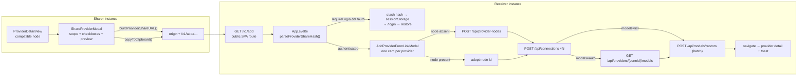

# Provider Share URL & Auto-Add Design
**Date:** 2026-11-01
**Status:** Proposed
**Scope:** share a custom OpenAI/Anthropic-compatible provider node (endpoint + credential + models) as one link, and turn that link back into a live provider on another 9router-go instance.

---

## 1. Goal

One URL carries everything a receiver needs to stand up the same provider node:

```
https://gateway.example.com/v1/add#prov=openai-compatible-chat-myprov&url=https%3A%2F%2Fapi.x.com%2Fv1&api=sk-live-xxx&models=auto&prefix=myprov&name=My%20Provider
```

And, for a pool of accounts, the same link with a structured credential block:

```
https://gateway.example.com/v1/add#prov=openai-compatible-chat-myprov&url=…&keys=Office%7Csk-aaa;Home%7Csk-bbb&models=limit%3D50
```

Opening either on any 9router-go instance resolves to: create-or-adopt the node, store the key(s), optionally import the model catalogue — with a confirmation step and no silent writes.

## 2. Problem

Today a compatible node is shared by talking someone through four dashboard fields (name, prefix, apiType, base URL), then the key, then "Import from /models". Each step is a place to typo. There is no artifact that represents "this provider, ready to add".

`ExportKeysModal` already copies raw keys, but the key alone is useless without the endpoint, the prefix and the model list — and a *pool* of keys has no shareable form at all.

## 3. Decisions taken

| # | Decision | Choice |
|:--|:--|:--|
| 1 | URL shape | Single `#` fragment parsed with `URLSearchParams`. No `#?…&…` chaining — `#` may appear once, so a second `#?` would land inside the fragment string and break every later parameter. A leading `?` inside the fragment is stripped so a hand-typed `#?prov=…` still parses. |
| 2 | Audience | The receiver must be authenticated to the dashboard before anything is written. The link page itself is public HTML; the write path is the existing dashboard REST API behind `RequireDashboardAuth`. |
| 3 | `prov` payload | The **full node id** (`openai-compatible-chat-myprov`, `anthropic-compatible-myprov`, or a registry provider id). `type`/`apiType`/`prefix` are derived from it when absent and carried explicitly when the sharer includes the endpoint. |
| 4 | Share modal | Full option set: credential scope (none / single / bulk / multi-provider), model mode (auto-fetch with filters / specified / none / ask), endpoint fields, display name, and a secret warning when a key is embedded. |
| 5 | Bulk credentials | `keys=`, one parameter, `;`-separated entries, `|`-separated fields. Replaces `api=` for the bulk case; `api=` stays for the single case. Both present in one link is a parse error, not a silent precedence. |
| 6 | Multi-provider | `set=`, base64url-encoded JSON array, capped at 8 entries and 4000 characters. `prov=` and `set=` are mutually exclusive for the same reason. |
| 7 | Model selection | `models=` accepts keywords, filter expressions and id lists. Filters (`free`, `caps:`, `ctx>=`) are applied client-side over what `GET /api/providers/{id}/models` returned, so they need no backend change. |
| 8 | No server state | No share-token table, no expiry, no revocation. The entire payload fits in a fragment the server never sees. |

## 4. Why the fragment, not the query string

The API key travels in the link. A fragment is never sent to the server, never lands in an access log, never appears in a `Referer`. A query string would put a live credential into every proxy log between the sharer and the receiver.

This is the same reasoning `web/src/lib/oauth-handoff.ts:129-132` already applies — it reads `u.searchParams` first and falls back to the hash. That precedent is the one this feature follows.

## 5. URL contract

### 5.1 Parameters

| Param | Scope | Required | Meaning |
|:--|:--|:--|:--|
| `prov` | single | yes (or `set`) | Node id or registry provider id |
| `set` | multi | yes (or `prov`) | base64url JSON array of provider objects; ≤8 entries, ≤4000 chars |
| `url` | both | for nodes | Base URL of the upstream endpoint, `http:`/`https:` only |
| `api` | both | no | One credential. Single-key links only. |
| `keys` | single node | no | Structured credential block (see §5.4). Mutually exclusive with `api`. |
| `models` | both | no | `auto` / `ask` / `none` / `free` / `caps:<cap>` / `ctx>=<n>` / `limit=<n>` / id list |
| `prefix` | nodes | yes for nodes | Model-id prefix, so the receiver's `<prefix>/<model>` matches the sharer's |
| `type` | nodes | no | `openai-compatible` \| `anthropic-compatible` \| `custom-embedding`. Derived from `prov`. |
| `apiType` | nodes | no | `chat` \| `responses`. Derived from `prov`. |
| `name` | both | no | Display name for the connection row |
| `note` | both | no | One line of sharer context, ≤200 chars, rendered read-only and HTML-escaped |

### 5.2 Deriving `type` / `apiType` from `prov`

`internal/handlers/dashboard/provider_node_id.go:providerNodeLiteralsForID` already defines the id grammar. The frontend replicates the same cases — a prefix test, not a lookup:

```ts
if (prov.startsWith('anthropic-compatible-')) return { type: 'anthropic-compatible', apiType: '' }
if (prov.startsWith('custom-embedding-'))     return { type: 'custom-embedding',     apiType: '' }
if (prov.startsWith('openai-compatible-responses-')) return { type: 'openai-compatible', apiType: 'responses' }
if (prov.startsWith('openai-compatible-chat-'))      return { type: 'openai-compatible', apiType: 'chat' }
```

### 5.3 Three bulk modes

"Bulk share" is three different features with different payloads and risks:

| Mode | What travels | Receiver gets |
|:--|:--|:--|
| **A — many keys, one endpoint** | one node + N credentials | N connections on that node, rotation ready |
| **B — one key, many models** | one node + one key + a curated catalogue | the provider with a filtered model list |
| **C — many providers** | several nodes, each optional key + models | several providers in one step |

Mode A is what the phrase usually means and is the one that needs a new parameter.

### 5.4 `keys=` — the structured credential block

`api=a,b,c` works but has three defects: no names, no separator escape (a cookie credential routinely contains `;`, `=` and sometimes `,`), and no per-key metadata. So bulk uses `keys=` instead.

```
keys=Office|sk-aaa;Home|sk-bbb;Backup|sk-ccc|pool=eunode|prio=3
```

Grammar — `;`-separated entries, `|`-separated fields inside an entry:

```
<name>|<key>[|pool=<proxyPoolId>][|prio=<n>]
```

- `name` — connection name. Empty is allowed; the receiver auto-names via `planBulkAdd` rules.
- `key` — the credential. May not contain `;` or `|`, because those are the delimiters. A key that genuinely contains them is refused with a message naming the character rather than silently truncating.
- `pool=` — optional proxy pool id. An id the receiver does not have is reported and skipped, never invented.
- `prio=` — optional rotation order, defaulting to the order in the list.

The syntax is the one `planBulkAdd` (`web/src/lib/bulk-add.ts:52`) already parses from the bulk-add textarea, and the same one **Export Keys** *Copy All* emits (`name: key` per line) — so a share and an export round-trip through the same parser.

**Encoding.** `URLSearchParams` leaves `;` and `|` literal, and chat clients rewrite URLs. The builder therefore percent-encodes the delimiters explicitly:

```ts
function encodeKeysBlock(entries: KeyEntry[]): string {
  return entries
    .map((e) => [e.name, e.key, ...(e.pool ? [`pool=${e.pool}`] : []), ...(e.prio ? [`prio=${e.prio}`] : [])]
      .map((part) => encodeURIComponent(part).replace(/;/g, '%3B').replace(/\|/g, '%7C'))
      .join('|'))
    .join(';')
}
```

The link is uglier and survives being pasted through Slack, WhatsApp and a QR scanner.

**`api` + `keys` together is a parse error.** Not a precedence rule. A link that half-works because one parameter was ignored is worse than one that says so.

### 5.5 `models=` values

| Value | Meaning |
|:--|:--|
| `auto` | fetch the upstream catalogue on add |
| `ask` | the receiver picks in the modal |
| `none` | import nothing |
| `free` | import only the free tier — same filter as **Import free only** (`ProviderDetailView.svelte:4220`) |
| `caps:vision` | import only models carrying that capability |
| `ctx>=128k` | import only models whose context window is at least 128k |
| `limit=50` | cap an `auto` fetch at N models |
| `id,id,id` | import exactly these |

The filters are applied **after** fetch, over the list `GET /api/providers/{id}/models` returned — a client-side filter, no backend change. `limit=` matters most: a provider with 400 models should not drop 400 rows into a fresh instance unasked.

Per-model metadata (capabilities, context window, reasoning flags) is **not** in the URL. The batch endpoint derives it from the upstream catalogue; putting it in the link would multiply its length for data the receiver can re-derive.

### 5.6 `set=` — many providers

`prov=` is single. Multi-provider uses a different shape:

```
#set=<base64url(JSON)>
```

```json
[
  {"prov":"openai-compatible-chat-a","url":"https://a.test/v1","prefix":"a","api":["sk-a"]},
  {"prov":"anthropic-compatible-b","url":"https://b.test/v1","prefix":"b","models":["m-1","m-2"]},
  {"prov":"deepseek","models":"auto"}
]
```

base64url rather than another delimited grammar: the payload is structured and nested, and a `;`/`|`/`,` grammar would need escaping rules at every level. `JSON.stringify` → `btoa` → URL-safe replace, decoder the exact inverse. **It is not encryption** — the modal must say *"anyone with this link can read everything in it"*, which is already true of every other parameter.

Hard cap: **8 providers and 4000 encoded characters**, enforced in `buildProviderShareURL` by returning an error the modal shows. Past that the artifact is a config file, and `ExportKeysModal` already covers it.

### 5.7 Length tiers

A credential block is the one case where the link exceeds every limit at once.

| Keys | Approx. length | Response |
|:--|:--|:--|
| 1–3 | 150–350 chars | Link only |
| 4–8 | 400–900 chars | Link only; fine in chat, tight in SMS |
| 9–20 | 1–3 KB | **Copy as two parts** offered |
| 20+ | 3 KB+ | Modal refuses to build a link |

Three tiers, not one warning:

1. **≤ 2000 chars** — link only.
2. **2000–4000 chars** — link, plus a **Copy as two parts** action: the link without credentials, and a separate `keys=` block the receiver pastes into the modal's *Paste bulk keys* field (the same textarea `AddConnectionModal`'s bulk mode uses).
3. **> 4000 chars** — the modal refuses and says so: use **Export Keys** for the credentials and share the provider link without them.

### 5.8 What the link never contains

- No dashboard credentials, no client API keys, no session token.
- No absolute paths into the sharer's database. `prov` is an id, and ids are portable by construction.
- No model ids the sharer invented locally and never verified upstream — the `specified` list is editable text before it is copied.
- No per-model metadata (§5.5).

## 6. Architecture



## 7. Backend changes

### 7.1 One route, one file

`internal/handlers/router.go`, in `SetupServerRouter`, beside the other SPA routes (`/providers`, `/connections`, `/combos`):

```go
// Provider share link: a fragment-only URL that the dashboard SPA resolves.
// Registered here, not under /dashboard/*, because the receiver may not have a
// session yet — the SPA gates the write itself and preserves the fragment
// across the login redirect. The fragment never reaches the server, so a key
// embedded in the link is never logged.
//
// It also must not go into SetupRoutes: that whole group is mounted inside
// RequireApiKey (router.go:627-631), so a /v1/add registered there would answer
// 401 to the browser that is supposed to open it.
r.Get("/v1/add", webH.ServeHTTP)
```

Place it beside `/connections` and `/providers` (`router.go:522` and `:528`), before the `/dashboard/*` group — chi matches literal segments independently, so `/v1/add` cannot be swallowed by `/v1/models` or the SPA routes.

**Not a dashboard REST route.** It serves the embedded SPA, so the two-table rule (`dashboard.RegisterRoutes` in `routes.go` for tests vs `SetupDashboardRoutes` in `router.go` for the binary) does not apply — there is no handler to unit-test through `setupTestRouter`.

### 7.2 No new REST endpoint, no new table

Everything the add flow needs already exists:

| Step | Endpoint | Notes |
|:--|:--|:--|
| Create the node with a readable id | `POST /api/provider-nodes` | `urlSuffix` = the tail of `prov`. `provider_nodes.go:121` |
| Store the key on that node | `POST /api/connections` | Auto-fills `providerSpecificData{prefix,apiType,baseUrl,nodeName}` from the node row. `connections.go:405` |
| Probe before saving | `POST /api/provider-nodes/validate` | `{valid,error,method,dimensions}`. `provider_nodes.go:389` |
| Fetch the upstream catalogue | `GET /api/providers/{connectionId}/models` | Takes a **connection id**, not a provider id. `connections.go:954` |
| Import the catalogue | `POST /api/models/custom` (batch form) | One transaction, reports `added` + `skipped[]`. `models_bulk.go:59` |
| Read back what landed | `GET /api/models/custom` | `{models:[…]}` |

Adding a `provider-shares` table with expiring tokens was considered and rejected: it introduces server state, a cleanup path and a revocation story for a feature whose entire payload already fits in a fragment the server never sees.

## 8. Frontend

### 8.1 New: `web/src/lib/providerShare.ts`

Pure encode/decode, no framework import, so it is unit-testable without a DOM.

```ts
export interface KeyEntry { name: string; key: string; pool?: string; prio?: number }
export interface ProviderShareLink {
  prov: string
  url: string
  api: string[]          // empty when credentials were excluded
  keys: KeyEntry[]       // bulk form; mutually exclusive with api
  models: 'auto' | 'ask' | 'none' | 'free' | ModelFilter | string[]
  prefix: string
  name: string
  note: string
  type: string
  apiType: string
}
export function buildProviderShareURL(origin: string, link: ProviderShareLink): string
export function parseProviderShareHash(hash: string): ProviderShareLink | ProviderShareLink[] | null
```

Parser rules:

- `prov` empty and no `set` → `null`. A link with only `prov` is valid ("add this provider, I'll paste the key").
- `api` and `keys` both present → parse error naming both parameters.
- `api` is split on `,`, trimmed, empties dropped. A single key is a one-element array.
- `keys=` is split on `;` (after percent-decoding), each entry on `|`. A field count outside 1–4, or a decoded `;`/`|` inside the key, is a parse error naming the entry.
- `models`: `auto`/`ask`/`none`/`free` are keywords; `caps:x` and `ctx>=n` are filters; a comma or newline makes it an id list.
- `url` must be `http:`/`https:`. A `javascript:` or `data:` URL is refused, not sanitised.
- A leading `?` inside the fragment is stripped, so `#?prov=…` parses like `#prov=…`.
- `note` trimmed to 200 chars.
- `set=` decoded via `atob` after base64url → base64; a malformed payload is a parse error, not an empty list.

### 8.2 New: `web/src/components/connections/ShareProviderModal.svelte`

Opened from `ProviderDetailView.svelte` beside **Export Keys** (both the compatible-node header at `:3377` and the registered-provider action row at `:4147`).

A **Scope** radio at the top selects which controls appear:

```
Scope:  ( ) This provider     (•) This provider + all keys     ( ) Several providers
        one link                bulk keys on one node             set= checklist
```

**This provider:**

| Control | Default |
|:--|:--|
| Credential scope radio: None / Single | None |
| Credential picker (Single) | first active connection |
| Model mode radio: Auto-fetch / Specified / None / Ask receiver | Auto-fetch |
| Model filter (Auto-fetch): none / free / caps / ctx>= / limit | none |
| Model list textarea (Specified) | seeded from `api.getCustomModels()` |
| ☑ Include base URL / prefix / display name | all on |

**This provider + all keys:**

- Credential scope becomes a **table**: every connection of the node with a per-row checkbox and an editable name, because exported names like `Key 1` are meaningless to a receiver. `keys=` is built from the checked rows.
- Optional per-row `pool=` and `prio=` inputs.

**Several providers:**

- A checklist of the operator's compatible nodes and registered providers, each expandable to its own credential/model controls.
- Non-compatible registry providers hide URL/prefix/type.
- `set=` is built from the checks.

Behaviour shared by all three scopes:

- The link preview updates live from a `$derived` calling `buildProviderShareURL`, so the operator sees the exact string they are about to copy. Rendered in a readonly `<input>` (not a `<p>`) so select-all-and-copy works when the clipboard API does not.
- Credential scope ≠ None renders a persistent warning: *"This link contains a live API key. Anyone who obtains it can spend your quota. Treat it like a password."*
- The three-tier length response from §5.7, driven by `builtURL.length`.
- `Copy link` uses `copyToClipboard` (`web/src/lib/clipboard.ts`), which already falls back for non-secure contexts, so a plain-HTTP localhost gateway still works.

### 8.3 New: `web/src/components/connections/AddProviderFromLinkModal.svelte`

The receiver-side confirmation. Nothing is written until **Add provider** is pressed. It takes `links: ProviderShareLink[]` — one card per provider — so the single and `set=` cases share one code path.

Per card:

| Field | Prefill | Editable |
|:--|:--|:--|
| Node id | `prov` | no — it is the identity the link pins |
| Base URL | `url` | yes |
| Prefix | `prefix` | yes |
| Type / apiType | derived from `prov` | no |
| API key | `api[0]`, masked, reveal toggle | yes |
| Connection name | `name`, else `<node name> Key` | yes |
| Model mode + filters | `models` | yes — the receiver can override `auto` with a typed list |
| Model list | from the link when `specified` | yes |
| Sharer note | `note` | no — read-only muted text |

Footer actions per card: **Validate** (`POST /api/provider-nodes/validate`, never writes) and **Add**. A single **Add all** runs every card in sequence and reports per-provider outcome.

Write sequence, per card, sequential, each failure aborts that card with the error shown inline:

1. `GET /api/provider-nodes` → find `prov`.
   - Found: adopt it. If the link's `url` differs from the stored `baseUrl`, ask *use stored* / *use link* — silently rewriting a live node's endpoint from a link is not acceptable.
   - Not found: `POST /api/provider-nodes` with `{name, prefix, apiType, baseUrl, type, urlSuffix: <tail of prov>}`. A `409` from `resolveProviderNodeID` (`provider_node_id.go:163`) surfaces as *"That provider id is taken on this instance — pick another."*
2. `POST /api/connections` with `{provider: prov, authType: "compatible", apiKey, name, priority: 1}`. `authType: "compatible"` is what `AddConnectionModal.svelte:63` already sends for nodes — `"apikey"` would take the wrong probe path.
3. Model import:
   - `auto` → `GET /api/providers/{connectionId}/models`, apply the filters, then batch-save.
   - `specified` → batch-save the listed ids.
   - `none` / `ask` with an empty list → skip.
4. `loadData()` + navigate to `/dashboard/providers/<prov>` + a toast naming how many models landed and how many were skipped (`skipped[]`, reported the way `reportImportRefusals` at `ProviderDetailView.svelte:2673` already does).

**Bulk tab** (when `keys` is non-empty): one row per entry — name, masked key, pool badge, priority. Rows with an unparseable entry are listed with the reason rather than dropped silently. On confirm the node is created once, then N sequential `POST /api/connections` calls, each named by `planBulkAdd` gap-fill rules so a collision becomes `Key 2`, never a silent replace (the `#4311` class of bug). A failure on row 4 leaves rows 1–3 created and names row 4.

### 8.4 `App.svelte` wiring

Three changes, all local:

1. **Detect the link.** Read `window.location.hash` once on mount: `parseProviderShareHash(window.location.hash)`. Non-null → render `AddProviderFromLinkModal` above the current tab. `/v1/add` falls through `pathToTab` to `'endpoint'`, which is harmless — the modal is driven by the parsed hash, not the tab.
2. **Survive login.** When `requireLogin` is on and the session is missing, `checkAuth()` navigates to `/login` and the fragment is lost to the redirect. Before that navigation, stash the raw hash: `sessionStorage.setItem('9router_pending_add', window.location.hash)`. On any mount, if that key exists, restore it into the same state and delete the key. `sessionStorage`, not `localStorage` — a pending link should not outlive the tab.
3. **Do not clobber it.** `navigate()` calls `window.history.replaceState`. Guard the `/` and `/dashboard` normalisation at `App.svelte:211` so it does not fire while an add link is open; otherwise the first navigation drops the hash.

## 9. Security

| Risk | Control |
|:--|:--|
| Credential in the link | Fragment-only. Never sent to the server, never in `Referer`, never in an access log. The modal defaults credential scope to `None` and warns loudly when it is not. |
| Link leaked in chat/history | The warning is on the link preview itself, not in a tooltip. The three-tier length response (§5.7) pushes large credential sets to **Export Keys**. |
| `set=` mistaken for encryption | base64url is encoding, not encryption. The modal states it in the `set=` scope. |
| Open write endpoint | There is none. `/v1/add` serves static HTML; every write goes through the existing dashboard REST group behind `RequireDashboardAuth`. |
| SSRF via `url` | Three layers. **Write time:** `POST /api/provider-nodes` runs the same `isValidHTTPURL` + `IsCloudMetadataURL` + `AssertPublicURL` checks as `/validate`, after the default base URL is filled in (`provider_nodes.go:179-196`) — a link's `url=` is the one path where an untrusted string reaches the node table, so the refusal happens before the row exists. **Parse time:** the frontend accepts only `http:`/`https:`. **Dial time (backstop):** `chat/resolution.go` builds every request client from `proxy.NewSafeTransport`, whose `ControlContext` returns `ErrSSRFBlocked` for private, loopback, link-local and cloud-metadata addresses after DNS resolution. |
| Malicious `javascript:` `url` | The parser accepts only `http:`/`https:`. |
| Node id squatting | `prov` is validated by `validateNodeIDSuffix` (`provider_node_id.go:135`) — pattern-capped, and it may not begin with `openai-compatible`/`anthropic-compatible`/`custom-embedding`. |
| Bulk keys without names | `planBulkAdd` (`web/src/lib/bulk-add.ts:52`) gap-fills collision-free `"<base> <n>"` names against the receiver's existing connection names, so a shared bulk paste cannot silently replace a stored key — the `#4311` class of bug. |
| Unknown `pool=` id | Reported and skipped. No proxy-pool row is invented. |
| `api` + `keys` ambiguity | A parse error, so no link half-works because one parameter was ignored. |
| Oversized `set=` | Rejected at build time by the 8-entry / 4000-char cap, not silently truncated. |

## 10. Edge cases

| Case | Behaviour |
|:--|:--|
| Link with `prov` only, no `url` | Valid. The modal requires the operator to type the base URL before **Add provider** enables. |
| Node already exists, different `baseUrl` | Adopt the stored node; show the difference and offer *use stored* / *use link*. Never silently rewrite. |
| Node id suffix collides on the receiver | `409` from the resolver, surfaced as a plain sentence, modal stays open. |
| `models=auto` but upstream has no `/models` | Empty list; the batch save is skipped and the toast says *"provider added, no models found upstream"*. |
| `models=list` with ids that already exist | Reported under `skipped[]` as `ALREADY_EXISTS`; the toast reports the count instead of failing the add. |
| `models=limit=50` and upstream returns 400 | First 50 are imported, the toast states the cap was applied. |
| `keys=` with a `;` inside a credential | Parse error naming the entry and the character. |
| `pool=` id absent on the receiver | The connection is still created; the unknown pool is reported. |
| `requireLogin` off | No redirect, no stash; the modal renders immediately. |
| Receiver opens the link twice | The second run finds the node and connection name and reports *"already added"* with a link to the provider page. |
| Sharer revokes the key after sharing | Nothing to revoke server-side — the accepted cost of a stateless link, and the reason the warning exists. |

## 11. Implementation phasing

The parameters are additive and independent, so they land in four phases. Each phase ships working; none is a stub.

| Phase | Parameters | Why here |
|:--|:--|:--|
| **1 — MVP** | `prov`, `url`, `api`, `models` (`auto`/`ask`/`none`/list), `prefix`, `type`, `apiType`, `name` | The whole feature is useful with one key and one endpoint. Establishes the route, the codec, both modals and the login stash. |
| **2 — model filters** | `models=free`, `caps:`, `ctx>=`, `limit=` | Pure client-side filtering over an existing response. Zero backend, zero new state, ~30 lines in `providerShare.ts` plus a select in the modal. |
| **3 — bulk credentials** | `keys=`, `note` | The parameter the request actually asked for. Needs the `;`/`|` codec, the per-key name table in the share modal, and the Bulk tab in the receiver modal. |
| **4 — multi-provider** | `set=` | Most complex, least often needed. Only worth building once a real request for it exists; the codec and the multi-card receiver from phase 3 make it cheap to add later. |

Phases 2–4 are each a separate PR against the phase-1 base. That keeps every diff reviewable and lets phase 1 ship to users while the rest is still being built.

## 12. Verification

Unit (`web/src/lib/providerShare.test.ts`, following `web/src/lib/bulk-models.test.ts`):

- Phase 1: missing `prov` → `null`; `#?prov=…` leading-`?` strip; single `api` split; `models` keyword vs list; `javascript:` url refused.
- Phase 2: `free`, `caps:vision`, `ctx>=128k`, `limit=50` each parse to their keyword; `ctx>=` with a malformed threshold falls back to `ask` rather than throwing.
- Phase 3: `keys=` round-trip — named entries, empty names, `pool=`/`prio=`, an encoded `%3B` inside a key; a decoded `;`/`|` inside a key is refused; `api` + `keys` together is a parse error; `note` trimmed to 200 chars.
- Phase 4: `set=` round-trip through base64url; >8 entries or >4000 chars returns an error.
- `buildProviderShareURL` round-trips every case the parser accepts.

Integration (`//go:build integration`, `make test-integration`) — the skill `9router-go-dashboard-route-two-tables` requires this, not package tests:

- `GET /v1/add` returns **200 with the SPA document** on a booted router, not 404 — the one assertion that catches a route registered only in the test table.
- `GET /v1/add` with `requireLogin` on and no session still returns 200.
- Phase 1 full flow against an `env.NewUpstream` fake: parse → create node → create connection → fetch `/models` → batch import → `GET /api/models/custom` shows the imported ids, and a chat request through the new alias reaches the fake upstream.
- Phase 3: `keys=` with 3 entries → all three connection rows exist under the node and the rotation order matches `prio=`. An unknown `pool=` id → the connection is still created, the pool reported, no proxy-pool row invented.
- Phase 4: `set=` with 3 providers → all three nodes and their connections land.

Manual smoke (required before hand-off):

- Build the gateway, open a real share link in a browser, complete the add, send one chat request through the new node, confirm the usage row lands.
- Grep the gateway log for the key string — it must not appear.
- Paste the built link into Slack/WhatsApp and reopen it: the encoded `;` and `|` survive.
- A 15-key share: the modal offers **Copy as two parts** and the receiver completes the add from the pasted block.

## 13. Out of scope

- Server-side share tokens with expiry/revocation. Rejected in §7.2; revisit only if a customer needs link invalidation.
- Sharing combos, proxy pools, plans or per-key model restrictions. The link describes providers.
- QR-code rendering of the link. Useful on mobile; not asked for, and `qr-code-styling` brings its own quiet-zone and capacity traps.
- Editing an existing provider *from* a link. The link creates or adopts; editing stays in `EditCompatibleNodeModal`.
- Encrypting the link. Needs a shared secret out-of-band, which defeats the point.

## 14. Task breakdown

| # | Task | Phase | Files | Done when |
|:--|:--|:--|:--|:--|
| 1 | Register `GET /v1/add` as a public SPA route | 1 | `internal/handlers/router.go` | Integration test returns 200 |
| 2 | `providerShare.ts` codec + tests | 1 | `web/src/lib/providerShare.ts`, `.test.ts` | `bun test` green |
| 3 | `ShareProviderModal.svelte` | 1 | `web/src/components/connections/` | Live preview, credential warning, length tiers |
| 4 | Wire the Share button into `ProviderDetailView` (both call sites) | 1 | `ProviderDetailView.svelte:3377`, `:4147` | Opens from a compatible node and from a registry provider |
| 5 | `AddProviderFromLinkModal.svelte` write sequence | 1 | `web/src/components/connections/` | Node + connection + models land; 409 and validate failures render inline |
| 6 | `App.svelte` hash detection, login stash, navigate guard | 1 | `web/src/App.svelte` | Link survives a login round-trip |
| 7 | `models=` filters | 2 | `providerShare.ts`, `ShareProviderModal.svelte` | Filter select renders; filters applied after fetch |
| 8 | `keys=` codec + per-key table + Bulk tab | 3 | `providerShare.ts`, `ShareProviderModal.svelte`, `AddProviderFromLinkModal.svelte` | 3 keys land with `prio=` order; parse errors name the entry |
| 9 | `set=` multi-provider | 4 | `providerShare.ts`, `AddProviderFromLinkModal.svelte` | Cap enforced; **Add all** reports per-provider outcome |
| 10 | `make vet-svelte`, `bun run build`, `du -sh dist` | each | — | Ratchet does not widen; weight reported |
| 11 | `.changes/<pr>-provider-share-url.md` | each | `.changes/` | Fragment written, `CHANGELOG.md` untouched |
| 12 | Browser smoke on a real gateway | 1 | — | §12 manual checks pass |
