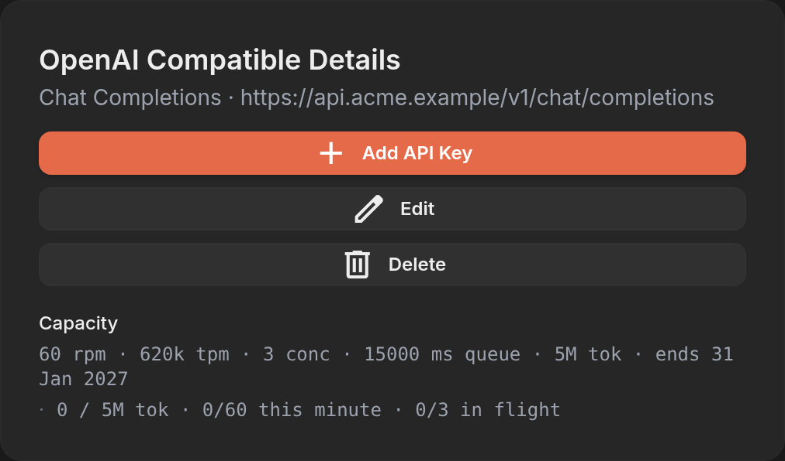
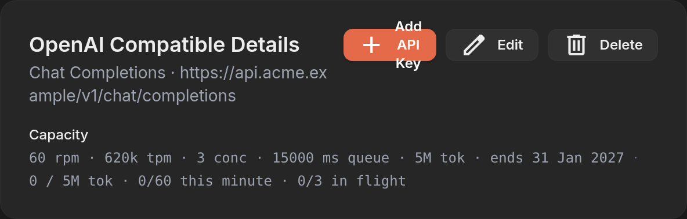
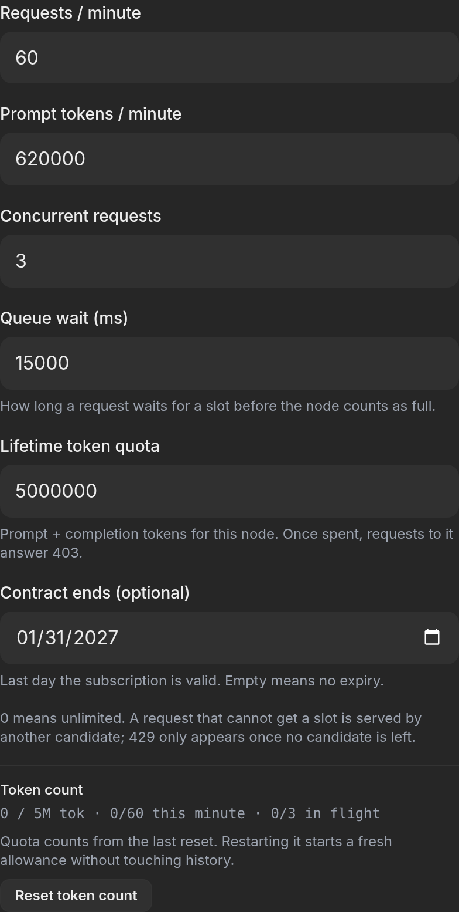
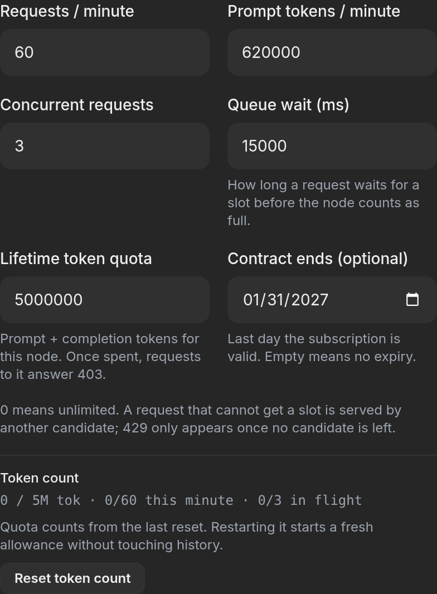

# Evidence — issue #473 (the narrow after-state capture for #432)

Recorded from a real `9router-go` binary on port 20999 with a temporary
`DATA_DIR`, not from a unit test or a component harness. Date: 2026-10-20.

The node under test carries the same policy the issue quotes, seeded through the
public API:

```
POST /api/provider-nodes                     {"name":"Acme Gateway","prefix":"acme",
                                              "baseUrl":"https://api.acme.example/v1",
                                              "apiType":"chat","type":"openai-compatible"}
PUT  /api/provider-nodes/<id>/limits         {"rpm":60,"tpm":620000,"concurrency":3,
                                              "tokenQuota":5000000,"queueTimeoutMs":15000,
                                              "contractExpiresAt":"2027-01-31"}
→ {"limits":{"rpm":60,"tpm":620000,"concurrency":3,"tokenQuota":5000000,
   "queueTimeoutMs":15000,"contractExpiresAt":"2027-01-31T00:00:00Z","expired":false,...}}
```

Captured with Chromium at `deviceScaleFactor: 2`. The narrow viewport is the
562 px the recording from #432 uses.

## 1. The narrow provider page, after the change

`ProviderDetailView.svelte:2915-2925` — the one-line summary where the inline
card used to be. Viewport 562 px:



Measured on that render, not read off the markup:

| property | 562 px |
|---|---|
| `Capacity` row | x 53..509, width 456, height 72 |
| summary span, single-line intrinsic width | 513 px |
| summary span, line boxes | 2 — 448 px, then 58 px |
| break point | after `5M tok · ends`, `31 Jan 2027` carries to line 2 |
| span `scrollWidth` / `clientWidth` | 456 / 456 — wraps, does not clip |
| row `scrollWidth` / `clientWidth` | 456 / 456 |
| `documentElement.scrollWidth` − `innerWidth` | 0 — no horizontal overflow |

The usage line next to it (`0 / 5M tok · 0/60 this minute · 0/3 in flight`,
325 px) stays on one line.

## 2. Where the wrap disappears

Same page, same node, viewport swept with `setViewportSize` and re-measured:

| viewport | summary line boxes | line widths |
|---|---|---|
| 320 | 3 | 202, 181, 116 |
| 360 | 3 | 246, 224, 29 |
| 375 | 2 | 246, 260 |
| 390-412 | 2 | 267, 238 |
| 480 | 2 | 347, 159 |
| 500-520 | 2 | 390, 116 |
| 540 | 2 | 426, 79 |
| **562** | **2** | **448, 58** |
| 600 | 2 | 477, 29 |
| 640 | 1 | 513 |
| 720, 900 | 1 | 513 |

The span needs 513 px of text width and the row hands it `viewport − 106` at these
widths, so the summary is two lines everywhere below ~619 px and one line above
it — 600 px is the last two-line width in the table, 640 px the first single-line
one.
`scrollWidth == clientWidth` at all fourteen widths, and
`documentElement.scrollWidth − innerWidth == 0` at all of them: the line wraps
rather than clipping or pushing the page wide, which is what
`ProviderNodeLimitsField.svelte:84-86` says it should do.

The 640 px render is the pair for the 562 px one:



## 3. The six-field grid below the `sm` breakpoint

The *Edit OpenAI Compatible* dialog with *Capacity limits* expanded
(`ProviderNodeLimitsField.svelte:99-130`), viewport 562 px:



```
getComputedStyle('#node-limits-fields .grid').gridTemplateColumns → "392px"
grid width 392, gap 16px, 6 inputs
header sub-line "Optional. Applied to every request routed through this node."
  → 1 line box, 340 px
dialog scrollWidth / clientWidth → 562 / 562
```

At 1024 px the same grid reports `"188px 188px"` over the same 392 px width —
two columns of 188 px, the shape the 487x526 still from #432 is a crop of:



## What this does and does not settle

Both states the issue says are only checkable on a narrow viewport are now on the
record: the two-line wrap of the summary (and its wrap point, ~619 px) and the
single-column form. Neither is a defect — the wrap is a wrap, not a clip, and the
page never scrolls sideways down to 320 px.

The other half of #473 is a wording fix in the **body of merged PR #432**, which
calls the 13.2 s recording the *after* state when it is the *before*: the card,
the six inputs and the **Save limits** button are still in it. Only the PR's
author or a maintainer can edit that body; this branch cannot, so the correction
is left where it was raised rather than restated here.
