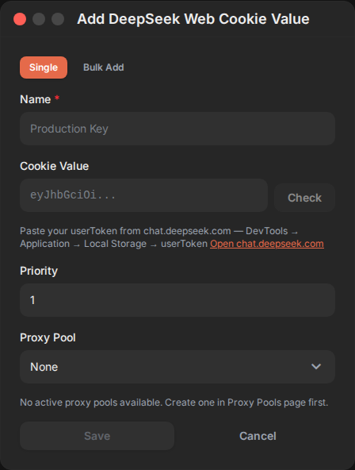
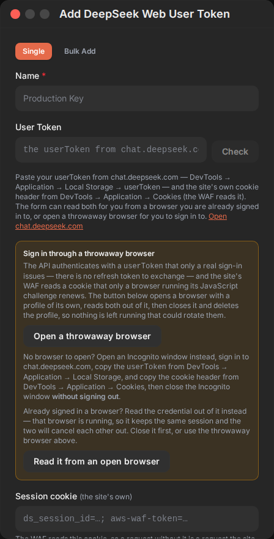
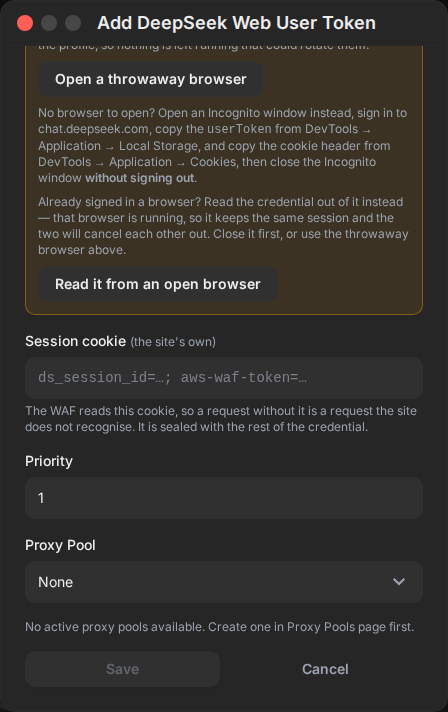
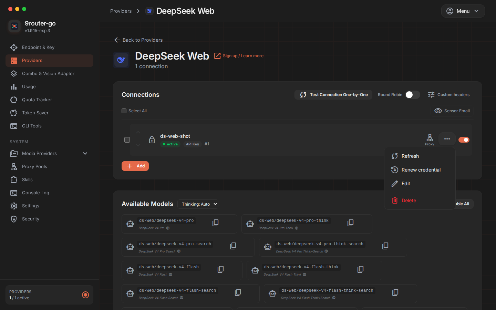

# Evidence — PR #538, the DeepSeek Web dashboard change

Captured from the two real gateway binaries, not from a mock: the **before**
side is the merge base (`7669175`), the **after** side is the PR head
(`13c06d84`). Each side was built (`bun run build` + `go build`), booted on
its own port with its own `DATA_DIR`, and driven with Chromium through the
dashboard's own login, so what the screenshots show is what an operator sees.

The rule this exists to satisfy is `.github/PULL_REQUEST_TEMPLATE.md:17-18`:
*"A UI change must carry before/after screenshots… A text review cannot show
overflow, contrast, or whether a control is reachable."*

## 1. The add-connection modal, before

The credential field is labelled **Cookie Value** with the placeholder
`eyJhbGciOi...`. Nothing tells the operator that the credential is a
`userToken` from `localStorage`, and there is no way to obtain one from the
form.

## 2. The add-connection modal, after

The same modal, now labelled **User Token** with the placeholder pointing at
`chat.deepseek.com` localStorage, and carrying:

- the extended hint, which names both halves of the credential (the `userToken`
  and the site's own cookie the WAF reads);
- **Open a throwaway browser** — opens a disposable profile, reads both halves
  out of it, closes it and deletes the profile;
- **Read it from an open browser** — reads the credential out of a browser the
  operator is already signed in to;
- a **Session cookie (the site's own)** field, sealed with the rest.

## 3. The footer, scrolled to the end

The modal body is longer than the viewport now, so the footer was checked
separately: the body is `max-h-[calc(85vh-100px)] overflow-y-auto`, and
**Save** and **Cancel** are reachable by scrolling it. Measured at three
viewport sizes:

| viewport | body scrollHeight / clientHeight | scrollable | Save in view after scrolling |
|---|---|---|---|
| 1440×900 | 1136 / 665 | yes | yes (y=745) |
| 1280×720 | — | yes | yes (y=745) |
| 1920×1080 | 1136 / 665 | yes | yes (y=745) |

Before the change the body was 544 px against a 544 px client height — no
scrolling needed. The longer form is the cost of telling the operator what
the credential actually is.

## 4. The row action menu, after

**Renew credential** appears in the per-connection menu, between **Refresh**
and **Edit**. The **before** side has no such item — the menu was **Refresh /
Edit / Delete** only.

## How these were captured

A Chromium instance logged into a throwaway gateway, opened
`/dashboard/providers`, clicked the **DeepSeek Web** tile, and opened the
add-connection modal. The screenshots are of the modal panel itself
(`docs/screenshots/`), taken from the live page, at a 1440 px viewport.
